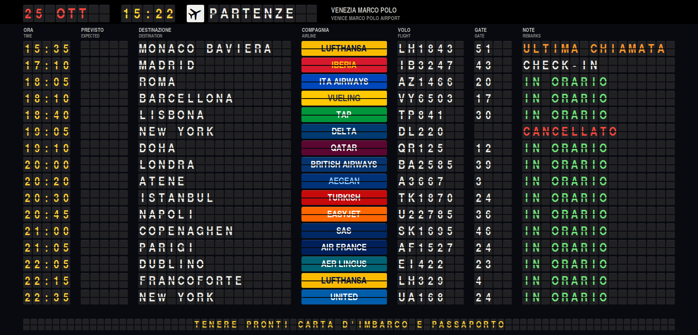
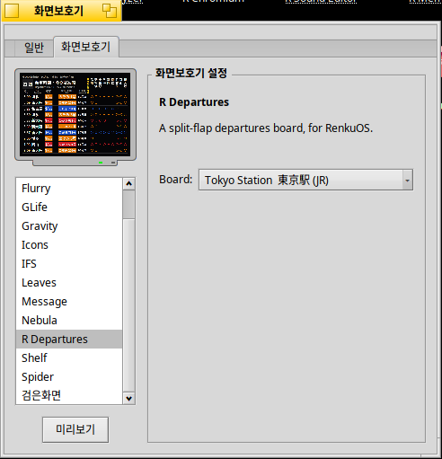
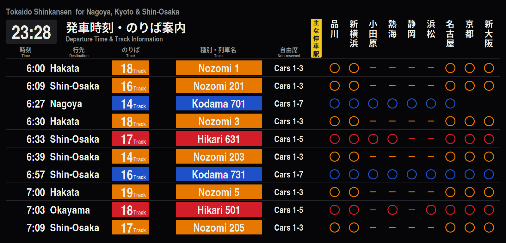

# R Departures screen saver


[English](README.md) | [日本語](README.ja.md) | [한국어](README.ko.md) | **Italiano**

[R Departures](https://github.com/rainygirl/renkuos-rdeparture) come salvaschermo
per RenkuOS (HaikuOS): un tabellone delle partenze di un aeroporto dove ogni
carattere è una paletta, oppure i tabelloni dei treni di Tokyo, Seul, London
Victoria e Sydney Central. Funziona su x86 a 32 bit (x86_gcc2), x86_64 e arm64.



## Installazione con pkgman

| Haiku | Aggiungere il repository |
| --- | --- |
| x86 a 32 bit (x86_gcc2) | `pkgman add-repo https://pkgman.rainygirl.com/x86_gcc2` |
| x86_64 | `pkgman add-repo https://pkgman.rainygirl.com/x86_64` |
| arm64 | `pkgman add-repo http://pkgman.rainygirl.com/arm64` |

```sh
pkgman install rdepartures_screensaver
```

Se `pkgman add-repo` fallisce con `Operation not supported`, il network kit di
quell'immagine non ha TLS: usare `http://` al posto di `https://`.

Su arm64 il pacchetto porta anche `libscreensaver.so` e le preferenze
**ScreenSaver**: le immagini arm64 di RENKU sono build minimum e non hanno né
l'una né le altre.

## Uso

1. Aprire **Deskbar -> Preferences -> ScreenSaver**.
2. Scegliere **R Departures** nell'elenco.
3. A destra, scegliere il tabellone in **Board**: Seul Incheon, Tokyo Narita,
   Hong Kong, Londra Heathrow, Parigi Charles de Gaulle, Milano Malpensa,
   Venezia Marco Polo, New York JFK, San Francisco, oppure una stazione --
   Tokyo, Seul, London Victoria, Sydney Central. L'applicazione lo sceglie con
   l'ingranaggio nell'angolo; un salvaschermo non si può cliccare, quindi qui è
   un'impostazione.
4. Con **Test** lo si vede a schermo intero; muovere il mouse o premere un tasto
   per uscire.




I tabelloni sono quelli dell'applicazione: il salvaschermo compila i sorgenti di
[rdepartures](https://github.com/rainygirl/renkuos-rdeparture), un submodule qui,
quindi cosa mostra ogni tabellone è descritto nel suo README.

## Compilare

```sh
git clone --recursive https://github.com/rainygirl/rdepartures-screensaver
```

Su Haiku, `make install` compila l'add-on e lo copia, con il carattere del
tabellone, in `~/config/non-packaged`. Su un ibrido x86 a 32 bit usare il `g++`
predefinito (gcc2): lì lo screen_blanker carica solo add-on gcc2.

Su una macchina con Docker, `tools/cross-build.sh all` compila in modo
incrociato `dist/x86/`, `dist/x86_64/` e `dist/arm64/`; la ricetta di
pkgman-repo ne fa i pacchetti. Per x86 l'add-on è solo un piccolo ponte gcc2
(`src/Bridge.cpp`): i tabelloni li disegna `rdepartures-saver-renderer`
(`src/Renderer.cpp`), compilato con il compilatore x86 dell'ibrido, in una
memoria condivisa fra i due. `make render` compila `test/render.cpp`, che fa
girare l'add-on fuori schermo e lo salva in un file PNG, per controllarlo via
ssh.

## Nessuna affiliazione

I nomi e i colori delle compagnie aeree servono a far sembrare vero il
tabellone; non ci sono loghi, e nulla qui è approvato da compagnie aeree,
aeroporti o ferrovie.

## Uso dell'IA

Parti di R Departures sono state sviluppate con l'aiuto di strumenti di programmazione basati sull'IA (Claude di Anthropic). Tutto il codice è stato rivisto e testato dall'autore.

## Licenza

MIT per il codice. Il carattere del tabellone,
`rdepartures/fonts/texgyreheroscn-bold.otf` (TeX Gyre Heros, di B. Jackowski e
J. M. Nowacki), è sotto la GUST Font License
(`rdepartures/fonts/GUST-FONT-LICENSE.txt`).
