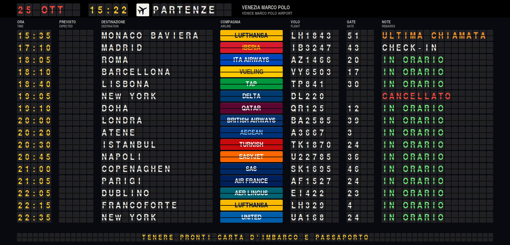
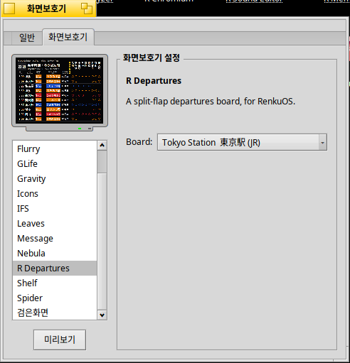
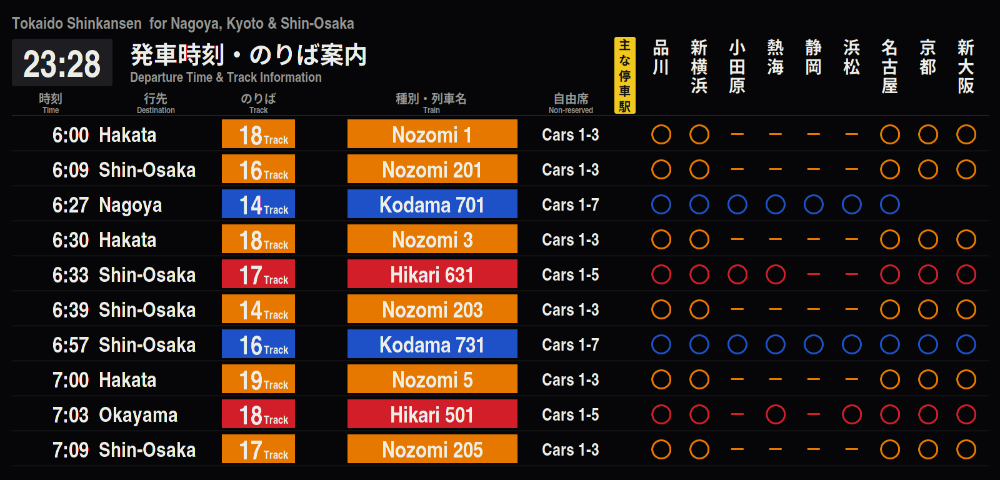

# R Departures スクリーンセーバー


[English](README.md) | **日本語** | [한국어](README.ko.md) | [Italiano](README.it.md)

[R Departures](https://github.com/rainygirl/renkuos-rdeparture) を RenkuOS (HaikuOS)
用のスクリーンセーバーにしたものです。文字の一つ一つがパタパタの空港出発案内板、または
東京駅、ソウル駅、ロンドン・ヴィクトリア駅、シドニー・セントラル駅の列車案内を表示します。
32 ビット x86 (x86_gcc2)、x86_64、arm64 で動きます。



## pkgman でインストール

| Haiku | リポジトリの追加 |
| --- | --- |
| 32 ビット x86 (x86_gcc2) | `pkgman add-repo https://pkgman.rainygirl.com/x86_gcc2` |
| x86_64 | `pkgman add-repo https://pkgman.rainygirl.com/x86_64` |
| arm64 | `pkgman add-repo http://pkgman.rainygirl.com/arm64` |

```sh
pkgman install rdepartures_screensaver
```

`pkgman add-repo` が `Operation not supported` で失敗する場合、そのイメージの
ネットワークキットには TLS がありません。`https://` の代わりに `http://` を
使ってください。

arm64 では `libscreensaver.so` と **ScreenSaver** 設定も一緒にインストールされます。
RENKU の arm64 イメージは minimum ビルドで、どちらも含まれていません。

## 使い方

1. **Deskbar -> Preferences -> ScreenSaver** を開きます。
2. 一覧から **R Departures** を選びます。
3. 右側の **Board** で案内板を選びます: 仁川、成田、香港、ヒースロー、シャルル・ド・
   ゴール、ミラノ・マルペンサ、ヴェネツィア・マルコ・ポーロ、ニューヨーク JFK、
   サンフランシスコ、または駅 (東京、ソウル、ロンドン・ヴィクトリア、シドニー・
   セントラル)。アプリでは隅の歯車で選びますが、スクリーンセーバーはクリックできない
   ので、ここで設定します。
4. **Test** で全画面表示を確かめます。マウスを動かすかキーを押すと終わります。




案内板はアプリと同じものです。スクリーンセーバーはこのリポジトリのサブモジュール
[rdepartures](https://github.com/rainygirl/renkuos-rdeparture) のソースからビルド
するので、それぞれの案内板の内容はそちらの README にあります。

## ビルド

```sh
git clone --recursive https://github.com/rainygirl/rdepartures-screensaver
```

Haiku では `make install` でアドオンをビルドし、案内板のフォントと一緒に
`~/config/non-packaged` にコピーします。32 ビット x86 ハイブリッドでは既定の
`g++` (gcc2) を使ってください。そこの screen_blanker は gcc2 のアドオンしか
読み込みません。

Docker のある作業用マシンでは `tools/cross-build.sh all` で `dist/x86/`、
`dist/x86_64/`、`dist/arm64/` をクロスビルドし、pkgman-repo のレシピがそれを
パッケージにします。x86 のアドオンは小さな gcc2 の中継 (`src/Bridge.cpp`) だけで、
案内板はハイブリッドの x86 コンパイラでビルドした `rdepartures-saver-renderer`
(`src/Renderer.cpp`) が、両者の共有メモリに描きます。`make render` は、アドオンを画面なしで動かして PNG ファイルに
保存する `test/render.cpp` をビルドします。ssh 越しの確認用です。

## 無関係であること

航空会社の名前と色は案内板らしく見せるために使っています。ロゴは含まれておらず、
どの航空会社・空港・鉄道会社もこのプログラムを承認していません。

## AI の利用について

R Departures は AI コーディングツール (Anthropic の Claude) の支援を受けて
開発しました。

## ライセンス

コードは MIT。案内板のフォント `rdepartures/fonts/texgyreheroscn-bold.otf`
(TeX Gyre Heros、B. Jackowski、J. M. Nowacki) は GUST Font License
(`rdepartures/fonts/GUST-FONT-LICENSE.txt`) です。
