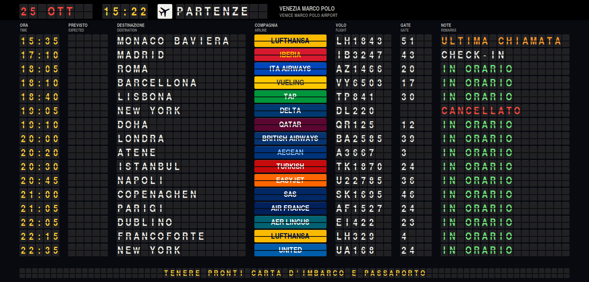
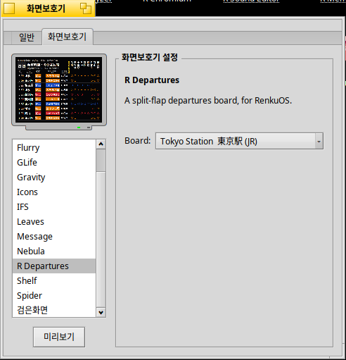
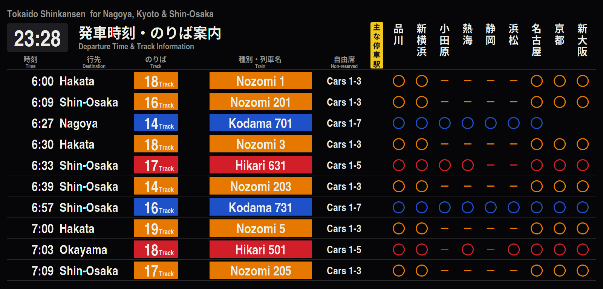

# R Departures 스크린세이버


[English](README.md) | [日本語](README.ja.md) | **한국어** | [Italiano](README.it.md)

[R Departures](https://github.com/rainygirl/renkuos-rdeparture)를 RenkuOS (HaikuOS)용
스크린세이버로 만든 것입니다. 글자 하나하나가 플립인 공항 출발 안내판, 또는 도쿄역,
서울역, 런던 빅토리아역, 시드니 센트럴역의 열차 안내판이 나옵니다. 32비트 x86
(x86_gcc2), x86_64, arm64에서 동작합니다.



## pkgman으로 설치

| Haiku | 저장소 추가 |
| --- | --- |
| 32비트 x86 (x86_gcc2) | `pkgman add-repo https://pkgman.rainygirl.com/x86_gcc2` |
| x86_64 | `pkgman add-repo https://pkgman.rainygirl.com/x86_64` |
| arm64 | `pkgman add-repo http://pkgman.rainygirl.com/arm64` |

```sh
pkgman install rdepartures_screensaver
```

`pkgman add-repo`가 `Operation not supported`로 실패하면 그 이미지의 네트워크
킷에 TLS가 없는 것입니다. `https://` 대신 `http://`를 사용하세요.

arm64에서는 `libscreensaver.so`와 **ScreenSaver** 환경설정도 함께 설치됩니다. RENKU
arm64 이미지는 minimum 빌드라 둘 다 빠져 있습니다.

## 사용

1. **Deskbar -> Preferences -> ScreenSaver**를 엽니다.
2. 목록에서 **R Departures**를 고릅니다.
3. 오른쪽 **Board**에서 안내판을 고릅니다: 인천, 나리타, 홍콩, 히드로, 샤를 드골,
   밀라노 말펜사, 베네치아 마르코 폴로, 뉴욕 JFK, 샌프란시스코, 또는 기차역(도쿄,
   서울, 런던 빅토리아, 시드니 센트럴). 앱에서는 구석의 톱니바퀴로 고르지만
   스크린세이버는 클릭할 수 없어서 여기서 설정합니다.
4. **Test**로 전체 화면에서 확인합니다. 마우스를 움직이거나 키를 누르면 끝납니다.




안내판은 앱의 것 그대로입니다. 스크린세이버는 이 저장소의 서브모듈인
[rdepartures](https://github.com/rainygirl/renkuos-rdeparture) 소스로 빌드하므로, 각
안내판이 무엇을 보여 주는지는 그쪽 README에 있습니다.

## 빌드

```sh
git clone --recursive https://github.com/rainygirl/rdepartures-screensaver
```

Haiku에서 `make install`을 실행하면 add-on을 빌드해서 안내판 폰트와 함께
`~/config/non-packaged`에 복사합니다. 32비트 x86 하이브리드에서는 기본 `g++`(gcc2)를
쓰세요. 그곳의 screen_blanker는 gcc2 add-on만 불러옵니다.

Docker가 있는 작업용 컴퓨터에서는 `tools/cross-build.sh all`이 `dist/x86/`(gcc2),
`dist/x86_64/`, `dist/arm64/`를 크로스 빌드하고, pkgman-repo의 레시피가 이것을
패키지로 만듭니다. `make render`는 add-on을 화면 없이 돌려 PNG 파일로 저장하는
`test/render.cpp`를 빌드합니다. ssh로 확인할 때 씁니다.

## 관계 없음

항공사 이름과 색상은 안내판처럼 보이게 하려고 쓴 것입니다. 로고는 넣지 않았고,
어느 항공사나 공항, 철도 회사도 이 프로그램을 승인하지 않았습니다.

## AI 고지

R Departures는 AI 코딩 도구(Anthropic의 Claude)의 도움을 받아 개발되었습니다.

## 라이선스

코드는 MIT입니다. 안내판 폰트 `rdepartures/fonts/texgyreheroscn-bold.otf`(TeX Gyre
Heros, B. Jackowski, J. M. Nowacki)는 GUST Font License
(`rdepartures/fonts/GUST-FONT-LICENSE.txt`)입니다.
