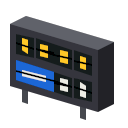
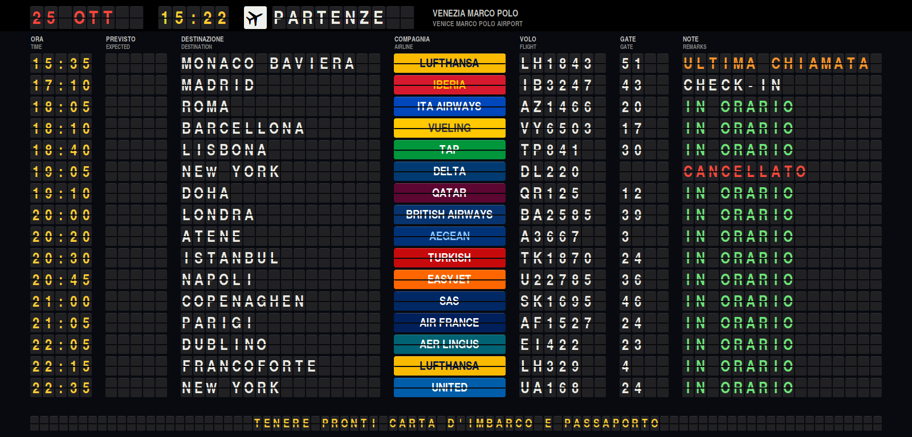
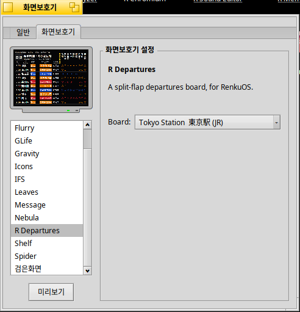
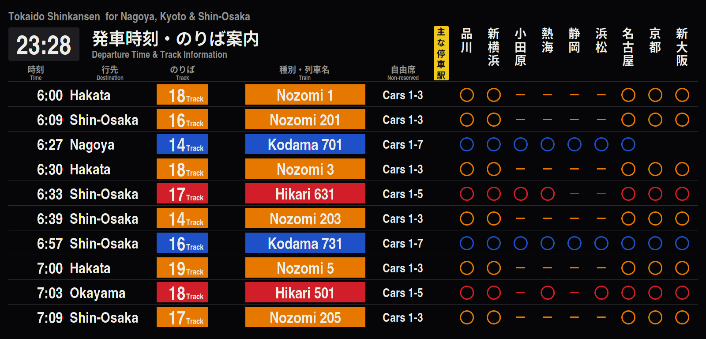

# R Departures screen saver



**English** | [日本語](README.ja.md) | [한국어](README.ko.md) | [Italiano](README.it.md)

[R Departures](https://github.com/rainygirl/renkuos-rdeparture) as a screen
saver for RenkuOS (HaikuOS): an airport departures board where every character
is a split flap, or the train boards of Tokyo, Seoul, London Victoria and
Sydney Central. Runs on 32-bit x86 (x86_gcc2), x86_64 and arm64.



## Install with pkgman

| Haiku | Add the repository |
| --- | --- |
| 32-bit x86 (x86_gcc2) | `pkgman add-repo https://pkgman.rainygirl.com/x86_gcc2` |
| x86_64 | `pkgman add-repo https://pkgman.rainygirl.com/x86_64` |
| arm64 | `pkgman add-repo http://pkgman.rainygirl.com/arm64` |

```sh
pkgman install rdepartures_screensaver
```

If `pkgman add-repo` fails with `Operation not supported`, the network kit of
that image has no TLS; use `http://` instead of `https://`.

On arm64 the package also brings `libscreensaver.so` and the **ScreenSaver**
preferences: RENKU arm64 images are minimum builds and leave both out.

## Use

1. Open **Deskbar -> Preferences -> ScreenSaver**.
2. Pick **R Departures** in the list.
3. On the right, pick the **Board**: Seoul Incheon, Tokyo Narita, Hong Kong,
   London Heathrow, Paris Charles de Gaulle, Milano Malpensa, Venezia Marco
   Polo, New York JFK, San Francisco, or one of the stations -- Tokyo, Seoul,
   London Victoria, Sydney Central. The app picks it from the gear in its
   corner; a screen saver cannot be clicked, so here it is a setting.
4. Use **Test** to see it full screen; move the mouse or press a key to leave.




The boards are the app's own: the screen saver builds the
[rdepartures](https://github.com/rainygirl/renkuos-rdeparture) sources, a
submodule here, so what each board shows is described in its README.

## Build

```sh
git clone --recursive https://github.com/rainygirl/rdepartures-screensaver
```

On Haiku: `make install` builds the add-on and copies it and the board font
into `~/config/non-packaged`. On a 32-bit x86 hybrid use the default `g++`
(gcc2): screen_blanker there only loads gcc2 add-ons.

On a workstation with Docker, `tools/cross-build.sh all` cross-builds
`dist/x86/` (gcc2), `dist/x86_64/` and `dist/arm64/`; the pkgman-repo recipe
packages those. `make render` builds `test/render.cpp`, which runs the add-on
off-screen into a PNG file, for checking it over ssh.

## Not affiliated

Airline names and colours are used to make the board look like one; no logos
are included, and nothing here is endorsed by any airline, airport or railway.

## AI disclosure

R Departures was developed with the assistance of AI coding tools (Anthropic's
Claude).

## License

MIT for the code. The board font, `rdepartures/fonts/texgyreheroscn-bold.otf`
(TeX Gyre Heros, by B. Jackowski and J. M. Nowacki), is under the GUST Font
License (`rdepartures/fonts/GUST-FONT-LICENSE.txt`).
